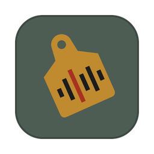

# Earmark

**Audio metadata manager**: tag, annotate, mark up and query collections of audio files.

Earmark runs locally on your computer. Your audio stays where it is, and your metadata lives in plain SQLite database files that belong to you.

 

---

## What it does

- **Import** audio files (WAV, MP3, FLAC, AIFF, M4A, OGG) from any folder
- **Custom fields**: parameters (numeric sliders), text, choice dropdowns, dates, tags, time-ranged markers, and data links to external files
- **Waveform and spectrogram player** with a time ruler, zoom, scrubbing, selection and playback speed; every file's length is shown
- **Markers**: drop time-stamped markers while listening, edit labels and times (millisecond resolution); one lane per markers field above the waveform, where you can select, move, copy, recolour and hide markers in groups
- **Detect sounds with plugins**: find where a sound happens by describing it (CLAP), discover what is in a recording (AST), or find more sounds like the ones you marked (see [`plugins/`](plugins/))
- **Link metadata files**: automatically pair transcriptions, pitch tracks, TextGrids etc. with audio by filename prefix, with their text indexed for search
- **Query and filter** the collection by any field, or by file information (length, sample rate, format, dates…); **statistics** and word-frequency tools in the built-in console
- **Multiple databases**: one `.db` file per project, with automatic backup snapshots
- **Export** to CSV, Excel, JSON, or a Max/MSP-friendly format
- **Max/MSP integration**: query an Earmark collection from Max (see [`max/`](max/))

---

## Getting started

### Option A: download the app (recommended)

Download the latest build from the [Releases](../../releases) page:

| Your computer | Download | Then |
|---|---|---|
| Mac with Apple Silicon (M1 or later) | `Earmark-macOS-AppleSilicon.zip` | Unzip, move `Earmark.app` to Applications |
| Mac with Intel processor | `Earmark-macOS-Intel.zip` | Unzip, move `Earmark.app` to Applications |
| Windows 10/11 | `Earmark-Windows.zip` | Unzip, open the `Earmark` folder, run `Earmark.exe` |

Not sure which Mac you have? Apple menu → **About This Mac**: "Chip: Apple M…" means Apple Silicon.

> **First launch on macOS:** the app isn't signed with an Apple developer certificate yet, so macOS will block it the first time. Open it once, then go to **System Settings → Privacy & Security** and click **Open Anyway**. You only need to do this once.
>
> **On Windows:** if SmartScreen appears, click **More info → Run anyway**.

### Option B: run from source

Requires [Python 3.8+](https://www.python.org/downloads/).

1. Download this repository (green **Code** button → **Download ZIP**) and unzip it.
2. Run the one-time setup:
   - **Mac:** open Terminal, drag `earmark_setup.sh` into the window, press Enter
   - **Windows:** double-click `earmark_setup.bat`
   - **Or manually:** `pip3 install -r requirements.txt`
3. Launch:
   - **Mac:** double-click `Earmark.command`
   - **Windows:** double-click `Earmark.bat`
   - **Or:** `python3 earmark.py`

Earmark opens in its own window. If pywebview isn't available it falls back to your web browser.

---

## Where your data lives

Databases are stored in **`~/Documents/Earmark/`** (on Windows: `Documents\Earmark\`). Each database is a single `.db` file, and backup snapshots go in a `backups/` folder next to it.

Earmark remembers the last database you opened and reopens it on launch. App settings and the waveform cache live in `~/.earmark/`; plugin analyses are cached in `~/Documents/Earmark/cache/`, never next to your recordings.

Audio files are **never copied or modified**. Earmark only stores their paths, so if you move your audio, re-import it.

A database can live anywhere, for example in the folder with its audio: **File → Save Database As…**, **New Database…** and **Open Database…** open the normal Finder dialogs.

**Exports** (File → Export to CSV / Excel / Export for Max, and **⌘S** to save the project as JSON) are written next to the current database, named after it (`archive_export.csv`, `archive_max.json` …), and shown in Finder.

---

## How to use

### Importing audio
Click **Import Audio**, then **Folder…** to pick a folder (optionally with its subfolders) or **Files…** to pick individual audio files in Finder. You can also type or paste a folder path. Files already in the database are skipped.

### Fields
In the left panel, click **+ New** and choose a type. With many fields, fold the ones you're not using: click the **▾** arrow next to a field (or its name in the file panel); **⌥-click** shows only that field, ⌥-click again shows them all.

| Type | Use for |
|------|---------|
| **Parameter** | Numeric values with a min/max range (e.g. Quality 0–10) |
| **Text** | Free-form notes |
| **Choice** | Dropdown options (e.g. Speech / Music / Ambient) |
| **Date** | Dates |
| **Tags** | Multiple labels per field |
| **Markers** | Time-ranged annotations on the audio |
| **Data Link** | A linked external file whose text is indexed and searchable |

### Linking metadata files
Click **Link Metadata**, enter the folder that holds your metadata files, and name the field (e.g. "Transcription").
Files are matched by prefix: `rec_001.wav` matches `rec_001.txt`, `rec_001_transcription.txt`, `rec_001_pitch.csv`, and so on.

### Markers
- Press **M** while playing to drop a marker at the playhead (or across the current selection)
- Click a marker on the timeline to jump to it; **⌥ + drag** near an edge to move it
- Double-click a marker's colour bar to change its colour
- Click a time or label to edit it
- **[** / **]** play the previous / next marker of the same name, to check them one by one

### Marker lanes
Above the waveform, under the time ruler, each markers field has its own lane.
- Click a lane's name to hide or show it; double-click a marker to rename it (or the whole selection); right-click for colour
- **Select:** click a marker, **⇧-click** to add, drag a box around several, **⌥-click** a marker to select every marker with that name, **⌥-click** a lane name to select the whole lane
- **Move:** drag the selection in time, or onto another lane (hold **⌥** to copy instead)
- **⌘C / ⌘V** copy and paste markers at the playhead; **Delete** removes the selection; **⌘Z** undoes any of it
- **On wave** (under the waveform) chooses how markers appear on the waveform itself: tabs, shading, or not at all

### Detecting sounds (plugins)
Click **Detect** next to a markers field. Plugins are optional add-ons that listen to the audio; Earmark itself contains no machine-learning code, and no model is downloaded until you install a plugin.

| Plugin | What it does | Install |
|---|---|---|
| **CLAP** | Describe a sound in words ("a duck quacking"); try phrasings live | `plugins/clap/install.sh` (about 3 GB with its libraries) |
| **AST** | 527 sound categories; leave the box empty to discover what is there | `plugins/ast/install.sh` (shares CLAP's libraries, model 350 MB) |
| **Fingerprint** | Finds exact repeats of a marked sound (same call, bell, engine) | nothing to install |

On Windows use `install.bat`. With the downloaded app, copy a plugin's folder into `Documents/Earmark/plugins/` and run its installer there.

- **Run** looks for the sounds typed in the box, in the whole file or only the selection
- The **score strip** shows one curve per sound: drag the threshold line and the markers follow, then **Make markers**
- **Find similar:** select example markers (or a range) and every plugin that can do it adds a candidate curve, so you can compare models side by side
- Markers made by a plugin are only replaced while untouched: anything you move, trim, rename or make yourself is kept

Anyone can write a plugin, in any language or framework: a folder with a `plugin.json` and a program that writes a small JSON file. Everything needed is in [`plugins/README.txt`](plugins/README.txt); `plugins/fingerprint/` is a complete example in one file.

### Query
Click **Query** to filter the collection: combine conditions on any field, then sort the results. Besides your own fields, the **File information** entries work on every file without being fields: name, folder, type, length (seconds or m:ss, e.g. `> 1:30`), sample rate, channels, bit depth, size, created and modified dates, and the recording date a field recorder writes into the file. Dates match from the start: `= 2025-04` is April 2025.

### Console
Click **Console** for statistics and text analysis, e.g. `stats Quality`, `stats audio`, `wordfreq Transcription 50`. Type `help` for the full list.

### Waveform and spectrogram
The **WAVE** and **SPECTRO** keys in the transport row choose what the audio lane shows: the waveform, the spectrogram, or both stacked (spectrogram on top). The spectrogram is calculated only for the part of the file on screen, and only while it is switched on, so it adds no load otherwise. It works with WAV files.

### Layout
- The **audio strip** (waveform and/or spectrogram) runs across the whole window under the toolbar. Drag the bar under it to make it taller or shorter.
- The **AUDIO · FIELDS · FILES · INFO** keys in the toolbar show or hide each panel (lamp on = shown). Hidden panels give their space to the others.
- Drag a panel's **title bar** onto another panel to swap their places; drag the gaps between panels to resize them.
- Earmark remembers your layout between sessions.

### Day and night
The interface has two themes: **Giorno** (day, the default) and **Notte** (night). Switch with the **Dark / Light** key in the toolbar.

### Keyboard shortcuts
Press **?** in the app to see every shortcut. Click **Customise** to change them: **+ Key** adds a key combination to an action (press it, or Esc to cancel), **×** removes one, and **Reset to defaults** puts everything back. A key that is already in use moves to the new action. Your shortcuts are saved in `~/.earmark/settings.json`.

The defaults:

| Shortcut | Action |
|----------|--------|
| `Space` | Play / pause (or play selection) |
| `Return` | Playhead to the start |
| `M` | Drop marker |
| `⌘⇧M` / `⌘⇧,` | Next / previous marker |
| `[` / `]` | Play the previous / next marker |
| `⌘C` / `⌘V` | Copy / paste selected markers |
| `S` / `G` | Selector / Grabber tool (also `F7` / `F8`) |
| `R` / `T` | Zoom in / out |
| `↑` / `↓` | Previous / next file |
| `⌘⇧J` / `⌘⇧K` / `⌘⇧L` | Search fields / files / content |
| `⌘Z` / `⌘⇧Z` | Undo / redo |

---

## Max/MSP integration

Query an Earmark collection from Max: find files by field, tag or text, get markers with their times, and play the results. Download **`Earmark-Max.zip`** from the [latest release](../../releases/latest) and put the `earmark-query` folder in `Documents/Max 9/Packages`. Setup and every message are in [`max/README.md`](max/README.md).

---

## Companion tools

- [`tools/batchmark.py`](tools/): bulk-import markers from transcription text files.

---

## Building the apps

Builds are made automatically by GitHub Actions (`.github/workflows/build.yml`) on macOS (Apple Silicon and Intel) and Windows:

- **Test build:** Actions tab → **Build apps** → **Run workflow**. The zips appear under *Artifacts* on the run page.
- **Release:** push a version tag (e.g. `v0.1.0`). The apps are built and attached to a draft Release, ready to review and publish.

---

## License

[MIT](LICENSE) © 2026 Stefano De Stefano

The interface uses the fonts [Archivo](https://github.com/Omnibus-Type/Archivo) and [B612 Mono](https://github.com/polarsys/b612), bundled in `ui/fonts/` under the SIL Open Font License (licence texts included).
