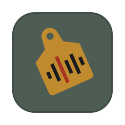

# Earmark

**Audio metadata manager**: tag, annotate, mark up and query collections of audio files.

Earmark runs locally on your computer. Your audio stays where it is, and your metadata lives in plain SQLite database files that belong to you.

 

---

## What it does

- **Import** audio files (WAV, MP3, FLAC, AIFF, M4A, OGG) from any folder
- **Custom fields**: parameters (numeric sliders), text, choice dropdowns, dates, tags, time-ranged markers, and data links to external files
- **Waveform player** with zoom, scrubbing, selection, playback speed and colour-coded markers on the timeline
- **Markers**: drop time-stamped markers while listening, drag their edges, edit labels and times (millisecond resolution)
- **Link metadata files**: automatically pair transcriptions, pitch tracks, TextGrids etc. with audio by filename prefix, with their text indexed for search
- **Query and filter** the collection by any field; **statistics** and word-frequency tools in the built-in console
- **Multiple databases**: one `.db` file per project, with automatic backup snapshots
- **Export** to CSV, Excel, JSON, or a Max/MSP-friendly format
- **Max/MSP integration**: query an Earmark collection from Max (see [`max/`](max/))

---

## Getting started

### Option A: download the app (recommended)

Download the latest build from the [Releases](../../releases) page:

| Your computer | Download | Then |
|---|---|---|
| Mac with Apple Silicon (M1 or later) | `Earmark-macOS-AppleSilicon.zip` | Unzip, move `Earmark.app` to Applications |
| Mac with Intel processor | `Earmark-macOS-Intel.zip` | Unzip, move `Earmark.app` to Applications |
| Windows 10/11 | `Earmark-Windows.zip` | Unzip, open the `Earmark` folder, run `Earmark.exe` |

Not sure which Mac you have? Apple menu → **About This Mac**: "Chip: Apple M…" means Apple Silicon.

> **First launch on macOS:** the app isn't signed with an Apple developer certificate yet, so macOS will block it the first time. Open it once, then go to **System Settings → Privacy & Security** and click **Open Anyway**. You only need to do this once.
>
> **On Windows:** if SmartScreen appears, click **More info → Run anyway**.

### Option B: run from source

Requires [Python 3.8+](https://www.python.org/downloads/).

1. Download this repository (green **Code** button → **Download ZIP**) and unzip it.
2. Run the one-time setup:
   - **Mac:** open Terminal, drag `earmark_setup.sh` into the window, press Enter
   - **Windows:** double-click `earmark_setup.bat`
   - **Or manually:** `pip3 install -r requirements.txt`
3. Launch:
   - **Mac:** double-click `Earmark.command`
   - **Windows:** double-click `Earmark.bat`
   - **Or:** `python3 earmark.py`

Earmark opens in its own window. If pywebview isn't available it falls back to your web browser.

---

## Where your data lives

Databases are stored in **`~/Documents/Earmark/`** (on Windows: `Documents\Earmark\`). Each database is a single `.db` file, and backup snapshots go in a `backups/` folder next to it.

Earmark remembers the last database you opened and reopens it on launch. App settings and the waveform cache live in `~/.earmark/`.

Audio files are **never copied or modified**. Earmark only stores their paths, so if you move your audio, re-import it.

---

## How to use

### Importing audio
Click **Import Audio**, enter a folder path and choose whether to include subfolders.

### Fields
In the left panel, click **+ New** and choose a type:

| Type | Use for |
|------|---------|
| **Parameter** | Numeric values with a min/max range (e.g. Quality 0–10) |
| **Text** | Free-form notes |
| **Choice** | Dropdown options (e.g. Speech / Music / Ambient) |
| **Date** | Dates |
| **Tags** | Multiple labels per field |
| **Markers** | Time-ranged annotations on the audio |
| **Data Link** | A linked external file whose text is indexed and searchable |

### Linking metadata files
Click **Link Metadata**, enter the folder that holds your metadata files, and name the field (e.g. "Transcription").
Files are matched by prefix: `B2213.wav` matches `B2213.txt`, `B2213_transcription.txt`, `B2213_pitch.csv`, and so on.

### Markers
- Press **M** while playing to drop a marker at the playhead (or across the current selection)
- Click a marker on the timeline to jump to it; **⌥ + drag** near an edge to move it
- Double-click a marker's colour bar to change its colour
- Click a time or label to edit it

### Console
Click **Console** for statistics and text analysis, e.g. `stats Quality`, `stats audio`, `wordfreq Transcription 50`. Type `help` for the full list.

### Waveform and spectrogram
The **WAVE** and **SPECTRO** keys in the transport row choose what the audio lane shows: the waveform, the spectrogram, or both stacked (spectrogram on top). The spectrogram is calculated only for the part of the file on screen, and only while it is switched on, so it adds no load otherwise. It works with WAV files.

### Layout
- The **audio strip** (waveform and/or spectrogram) runs across the whole window under the toolbar. Drag the bar under it to make it taller or shorter.
- The **AUDIO · FIELDS · FILES · INFO** keys in the toolbar show or hide each panel (lamp on = shown). Hidden panels give their space to the others.
- Drag a panel's **title bar** onto another panel to swap their places; drag the gaps between panels to resize them.
- Earmark remembers your layout between sessions.

### Day and night
The interface has two themes: **Giorno** (day, the default) and **Notte** (night). Switch with the **Dark / Light** key in the toolbar.

### Keyboard shortcuts
Press **?** in the app to see every shortcut. Click **Customise** to change them: **+ Key** adds a key combination to an action (press it, or Esc to cancel), **×** removes one, and **Reset to defaults** puts everything back. A key that is already in use moves to the new action. Your shortcuts are saved in `~/.earmark/settings.json`.

The defaults:

| Shortcut | Action |
|----------|--------|
| `Space` | Play / pause (or play selection) |
| `M` | Drop marker |
| `⌘⇧M` / `⌘⇧,` | Next / previous marker |
| `S` / `G` | Selector / Grabber tool (also `F7` / `F8`) |
| `R` / `T` | Zoom in / out |
| `↑` / `↓` | Previous / next file |
| `⌘⇧J` / `⌘⇧K` / `⌘⇧L` | Search fields / files / content |
| `⌘Z` / `⌘⇧Z` | Undo / redo |

----------|--------|
| `Space` | Play / pause (or play selection) |
| `M` | Drop marker |
| `⌘⇧M` / `⌘⇧,` | Next / previous marker |
| `R` / `T` | Zoom waveform in / out |
| `G` / `S` | Grabber / Selector tool |
| `↑` / `↓` | Navigate files |
| `⌘⇧J` / `⌘⇧K` / `⌘⇧L` | Search fields / files / content |
| `⌘Z` / `⌘⇧Z` | Undo / redo |

---

## Max/MSP integration

Query an Earmark collection from Max: find files by field, tag or text, get markers with their times, and play the results. Download **`Earmark-Max.zip`** from the [latest release](../../releases/latest) and put the `earmark-query` folder in `Documents/Max 9/Packages`. Setup and every message are in [`max/README.md`](max/README.md).

---

## Companion tools

- [`tools/batchmark.py`](tools/): bulk-import markers from transcription text files.

---

## Building the apps

Builds are made automatically by GitHub Actions (`.github/workflows/build.yml`) on macOS (Apple Silicon and Intel) and Windows:

- **Test build:** Actions tab → **Build apps** → **Run workflow**. The zips appear under *Artifacts* on the run page.
- **Release:** push a version tag (e.g. `v0.1.0`). The apps are built and attached to a draft Release, ready to review and publish.

---

## License

[MIT](LICENSE) © 2026 Stefano De Stefano

The interface uses the fonts [Archivo](https://github.com/Omnibus-Type/Archivo) and [B612 Mono](https://github.com/polarsys/b612), bundled in `ui/fonts/` under the SIL Open Font License (licence texts included).
